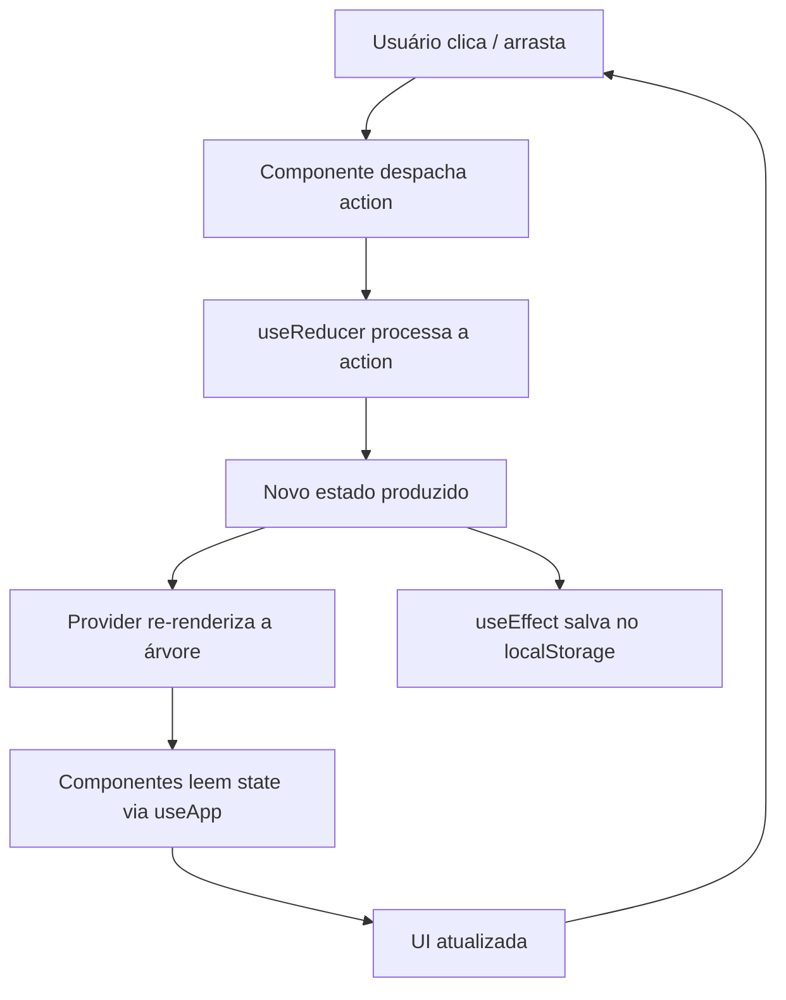

# GuildRun Team Builder Pro

Planejador de equipes para o jogo GuildRun (Leyline), com arena hexagonal sobre cenário atmosférico, sinergias de classe em tempo real, gerenciamento de itens e relíquias, habilidades e especializações por rank, estatísticas calculadas e exportação de builds em JSON. Projeto de fã com finalidade educacional, desenvolvido como estudo de migração de JavaScript puro para React com TypeScript.

## Visão geral

O planner resolve um problema prático do jogador de GuildRun: testar composições de equipe antes de entrar em combate. Nele é possível posicionar até 6 heróis em um campo de batalha hexagonal de 28 células sobreposto a um cenário de terreno — ou distribuir entre campo e reservas (até 3), num total de 6 heróis —, equipar 5 itens por personagem, adicionar relíquias globais, definir rank e especialização, e observar como sinergias e estatísticas respondem a cada mudança, tudo recalculado instantaneamente.

A interface é organizada em três zonas visíveis simultaneamente no desktop: análise (sinergias, estatísticas e relíquias), arena central (campo de batalha com cenário, painel de detalhes e equipamento) e biblioteca de heróis (busca, filtro por classe e cards).

## Funcionalidades

**Heróis e posicionamento**

- Biblioteca com os 25 heróis do jogo, com busca por nome e função, filtro por classe (7 classes com ícones SVG) e ordenação alfabética.
- Campo de batalha hexagonal com 28 células (4 linhas × 7 colunas em malha favo de mel), onde cada célula corresponde a um índice do array de estado.
- Até 6 heróis em campo e até 3 em reservas, num total máximo de 6; a distribuição entre campo e reserva é livre, respeitando os limites individuais.
- Posicionamento por dois cliques: clique no herói da biblioteca, depois em um hexágono vazio.
- Movimentação por dois cliques: clique em um herói posicionado para selecioná-lo, clique de novo para pegá-lo, clique em outro hexágono para mover ou trocar de posição.
- Arrastar e soltar via sistema customizado de Pointer Events: da biblioteca direto para qualquer hexágono vazio ou slot de reserva, entre hexágonos ocupados (troca) e entre campo e reservas.
- A roda do mouse funciona durante o arraste, permitindo scrollar a página enquanto segura um herói.
- Botão de remover (X) visível no hover de cada herói posicionado e no painel de detalhes.
- Tecla `ESC` cancela posicionamento ou movimentação.

**Rank, habilidades e especializações**

- Painel de detalhes do herói selecionado, exibido acima do equipamento, com retrato hexagonal, nome, função tática e classes.
- Habilidade base de cada herói (rank C) exibida com nome, tipo (ativa ou passiva) e descrição completa, referenciada de guildrunbuild.com.
- Seletor de rank em formato de pills (C, B, A, S), coloridos por nível.
- Três cartões de especialização por herói (75 no total), desbloqueados no rank B, com tier (S a D), tipo (ativa ou passiva), descrição e indicador de slots extras de item.
- Atributos base individuais exibidos em chips.
- Resumo dos itens equipados com ícones reais e raridade.

**Itens**

- 5 slots de itens por herói, gerenciados através de um seletor inline que abre ao clicar nos mini-itens do herói selecionado ou no painel de equipamento.
- Ícones reais do jogo para 163 dos 170 itens, com moldura colorida pela raridade.
- O seletor bloqueia itens já equipados em outro slot do mesmo herói.
- Clicar no item atual (destacado em verde) desequipa o item.

**Relíquias**

- Até 298 relíquias globais do time, gerenciadas num seletor inline com filtro por raridade.
- Ícones reais do jogo para 293 das 298 relíquias.
- Adição e remoção direto na lista equipada, com contador no cabeçalho do painel.

**Sinergias e estatísticas**

- Painel de sinergias mostra todas as classes presentes na composição, ativas ou não, com contagem de heróis, pontos de limiar (2/3/4), barra de progresso e dica de quantos heróis faltam para o próximo nível.
- Heróis híbridos (com classe secundária) contam para ambas as sinergias.
- Painel de estatísticas exibe o DPS estimado em destaque, seguido da grade de atributos somados (HP, ataque, defesa, magia, velocidade, crítico, mana etc.).
- Os valores refletem heróis + itens equipados + relíquias globais.

**Exportação e persistência**

- Exportação da build em JSON para a área de transferência, incluindo heróis, itens, relíquias, sinergias ativas, estatísticas e DPS.
- Salvamento automático no `localStorage` a cada mudança, com indicador visual de estado salvo no cabeçalho.
- Nome da composição editável no cabeçalho, persistido separadamente.
- Confirmação inline para limpar a composição (dois cliques no botão, sem diálogo nativo).

## Tecnologias

| Tecnologia | Uso |
|---|---|
| React 19 | Camada de interface, componentes funcionais com hooks |
| Vite 7 | Bundler e servidor de desenvolvimento |
| TypeScript | Tipagem estática do núcleo (reducer, contexto, utilitários, hooks, dados de habilidades) |
| Context API + `useReducer` | Estado global compartilhado, com toda a lógica de mutação centralizada em um reducer |
| CSS global | Um único arquivo de estilos (`src/index.css`) com custom properties para design tokens, sem frameworks CSS |
| Pointer Events | Sistema de arrastar customizado (`useHeroDrag.js`) — permite scroll do mouse durante drag, substituindo o HTML5 Drag and Drop nativo |
| `localStorage` | Persistência da composição (`guildrun_pro`) e do nome da build (`guildrun_build_name`) |
| SVG inline | Ícones de classe renderizados por um componente React, sem dependência de fontes de ícones |
| `clip-path` CSS | Molduras hexagonais nas células e retratos |
| GitHub Actions | Deploy automático para GitHub Pages a cada push em `main` |

Não há dependências de UI, gerenciamento de estado ou drag-and-drop — apenas `react`, `react-dom`, `vite`, `typescript` e `@vitejs/plugin-react`.

## Arquitetura

A aplicação segue fluxo de dados unidirecional: os componentes despacham ações (`dispatch`), o reducer produz o novo estado, e a interface re-renderiza a partir do novo valor. Nenhum componente modifica estado diretamente.

**Estado global** — gerenciado por `AppContext` com `useReducer`. O reducer concentra toda a lógica de negócio: escalar herói, posicionar em hexágono específico, mover/trocar entre posições, equipar/desequipar itens, adicionar/remover relíquias, definir rank e especialização, filtrar a biblioteca e resetar a composição. O estado inclui campos transitórios (`selectedCharId`, `placementCharId`, `placementFrom`) que não são persistidos, e `heroConfigs` (rank e especialização por herói) que é persistido.

**Estado local** — usado apenas para questões visuais de curta duração: o seletor de itens aberto (`useState` em `TeamGrid`), o estado de confirmação do botão Limpar e o indicador de "Salvo" (`useState` em `Header`), e o estado de colapso da biblioteca (`useState` em `HeroPool`).

**Sistema de arraste customizado** — o hook `useHeroDrag.js` substitui o HTML5 Drag and Drop nativo (que bloqueia eventos de roda do mouse durante drag). Baseado em Pointer Events com threshold de 5px para distinguir clique de arraste, ghost visual que segue o cursor, e detecção do alvo via `document.elementFromPoint()` no `pointerup`. O estado real da aplicação é atualizado via `dispatch` das mesmas ações do reducer.

**Dados estáticos** — três arquivos: `src/data/data.js` (heróis, itens, relíquias e sinergias por classe), `src/data/specializations.js` (75 especializações, 3 por herói) e `src/data/heroAbilities.ts` (habilidade base de cada herói no rank C). Nenhum componente altera esses dados.

**Utilitários** — funções puras tipadas em TypeScript que recebem o estado ou dados como parâmetros: `helpers.ts` (busca por ID, contagens, verificação de time), `synergies.ts` (cálculo de sinergias e análise de classes com limiares), `stats.ts` (soma de atributos e cálculo de DPS), `exportBuild.ts` (serialização e cópia para clipboard).

**Persistência** — um `useEffect` no `AppProvider` salva automaticamente o subconjunto persistido (`main`, `reserve`, `items`, `teamRelics`, `heroConfigs`) no `localStorage` a cada mudança de estado. Na inicialização, `createInitialState()` carrega o estado salvo e expande o array `main` para o tamanho do tabuleiro (28 posições), com compatibilidade retroativa para saves de qualquer tamanho anterior.

## Fluxo de dados



Ações do reducer despachadas pela interface:

- `SELECT_CHAR` — adiciona herói ao primeiro hexágono vazio (ou à reserva se o campo está cheio)
- `DROP_CHAR` — posiciona herói em um hexágono ou slot de reserva específico, respeitando os limites de 6 no campo e 3 na reserva
- `SWAP_SLOTS` — move ou troca dois heróis entre quaisquer posições (hexágono ↔ hexágono, hexágono ↔ reserva, reserva ↔ reserva)
- `SET_PLACEMENT_CHAR` / `CLEAR_PLACEMENT_CHAR` — gerencia o herói "pego" para posicionamento ou movimentação por dois cliques
- `SELECT_SLOT` — seleciona um herói posicionado (para visualizar detalhes, itens e equipamento)
- `REMOVE_CHAR` — remove um herói de uma posição específica (campo ou reserva)
- `MOVE_CHAR` — move um herói entre campo e reserva
- `SET_ITEM` / `REMOVE_ITEM` — equipa ou desequipa item em um slot
- `ADD_RELIC` / `REMOVE_RELIC` — adiciona ou remove relíquia global
- `SET_HERO_RANK` — define o rank do herói (C, B, A, S); ao voltar para C, limpa a especialização
- `SET_HERO_SPEC` — define a especialização do herói (bloqueada se rank é C)
- `SET_CLASS_FILTER` / `SET_SEARCH_QUERY` — filtros da biblioteca
- `RESET_TEAM` — limpa toda a composição

## Estrutura do projeto

```
src/
  main.jsx                     Entrada: renderiza App envolto pelo AppProvider
  App.jsx                      Layout de 3 colunas (análise / arena / biblioteca)
  index.css                    Folha de estilos global (design tokens + componentes)
  types.ts                     Tipos compartilhados (Hero, AppState, AppAction, etc.)
  data/
    data.js                    HEROES_DATA, ITEMS_DATA, RELICS_DATA, SYNERGY_CONFIG
    specializations.js          75 especializações (3 por herói, com tier e descrição)
    heroAbilities.ts            Habilidade base (rank C) de cada um dos 25 heróis
  context/
    AppContext.tsx             Context + Provider + persistência automática
    initialState.ts             Estado inicial, limites (6 campo / 3 reserva), expansão de saves
    reducer.ts                  Todas as ações (posicionamento, itens, relíquias, rank, filtros, reset)
  hooks/
    useApp.ts                  useContext(AppContext) com verificação de null
    useHeroDrag.js              Sistema de arraste customizado via Pointer Events
    useLocalStorage.js          Hook genérico (disponível, não usado pelo estado principal)
  utils/
    helpers.ts                  Busca por ID, contagens, verificação de time
    synergies.ts                calculateSynergies, analyzeClassCounts (limiares 2/3/4)
    stats.ts                    calculateTeamStats, calculateDPS
    exportBuild.ts              Serialização JSON + clipboard
  components/
    Header.jsx                  Cabeçalho: nome da build, contagem, exportar, limpar
    ClassIcon.jsx               Ícones SVG das 7 classes
    SynergyPanel.jsx            Sinergias com limiares, dots e barra de progresso
    StatsPanel.jsx               DPS em destaque + grade de atributos
    HeroPool/                   Biblioteca: HeroPool, HeroCard, Filters
    Team/                       Arena: HexBoard, HexCell, TeamGrid, Equipment, HeroInspector, MiniItems
    Items/                      Seletor de itens inline (ItemPicker)
    Relics/                     Lista e seletor de relíquias (RelicList, RelicItem)
public/assets/
    banner.webp                 Banner oficial do jogo
    battlefield-background.png  Cenário do campo de batalha (1536×1024px)
    heroes/                     25 retratos de heróis
    items/                      163 ícones de itens
    relics/                     293 ícones de relíquias
```

## UX/UI e interação

**Layout de três colunas** — no desktop, a tela é dividida em análise (esquerda), arena central e biblioteca (direita), todas visíveis simultaneamente. A página rola como um todo, sem containers de rolagem por coluna. Em telas menores, o layout muda para coluna única com a biblioteca recolhível.

**Campo de batalha** — 28 células hexagonais (4 linhas × 7 colunas uniformes, com offset de meio hexágono nas linhas ímpares para encaixe favo de mel), dispostas sobre uma imagem de cenário com vinheta atmosférica. As células vazias são translúcidas, com preenchimento escuro sutil e um "+" discreto, permitindo ver o terreno através delas. As células ocupadas exibem o retrato do herói com moldura dourada em degradê, nome sobreposto em gradiente, ícones de classe e mini-itens equipados.

**Estados das células** — vazio (translúcido com "+"), hover (realce dourado sutil), selecionado (contorno dourado com glow), pego para mover (elevado com pulso dourado), destino de arraste (realce verde), destino válido para troca (contorno dourado), foco por teclado (outline dourado). Transições curtas de 0.15–0.2s.

**Posicionamento por dois cliques** — o usuário clica em um herói da biblioteca (o card fica com borda dourada pulsante), depois clica em um hexágono vazio (que pulsa em âmbar durante a seleção). Para mover um herói posicionado: primeiro clique seleciona (mostra o painel de detalhes e equipamento), segundo clique no mesmo herói o "pega" (eleva com pulso dourado), e o próximo clique em qualquer hexágono move ou troca de posição. A tecla `ESC` cancela a qualquer momento.

**Arrastar e soltar** — o sistema customizado via Pointer Events permite arrastar heróis da biblioteca para o tabuleiro ou reservas, entre hexágonos (com troca ao soltar em célula ocupada), do campo para as reservas e das reservas de volta ao campo. Um ghost hexagonal com o retrato do herói segue o cursor durante o arraste. A roda do mouse funciona normalmente durante o arraste, permitindo scrollar a página sem soltar o herói. O threshold de 5px distingue clique de arraste.

**Feedback sem popups** — a aplicação não usa diálogos nativos, modais ou notificações flutuantes. Todas as confirmações e feedbacks são inline: o botão "Limpar" muda para "Confirmar limpeza?" no primeiro clique, o botão "Exportar" muda para "Copiado!" ao copiar, e o indicador "Salvo" pisca quando a persistência grava o estado.

**Seletor de itens inline** — ao clicar nos mini-itens do herói selecionado ou nos slots de equipamento, um painel seletor aparece abaixo com a lista de 170 itens (ícone, nome, tipo, raridade e stats). O item equipado no slot atual é destacado em verde; clicar nele desequipa. Itens já equipados em outro slot aparecem esmaecidos e não são clicáveis.

**Painel de sinergias** — cada classe presente na composição tem sua própria linha com ícone SVG, contagem de heróis, pontos de limiar preenchidos (2/3/4), barra de progresso rumo ao próximo nível e texto de bônus ativo. Classes inativas mostram "+N para ativar".

**Painel de detalhes do herói** — ao selecionar um herói posicionado, o `HeroInspector` aparece acima do equipamento com retrato hexagonal, nome, função tática, classes com ícones SVG, botão de remover (X), a habilidade base do rank C com nome, tipo e descrição, pills de rank (C/B/A/S coloridos por nível) e três cartões de especialização. Ao mudar o rank para B, A ou S, os cartões desbloqueiam e a descrição da especialização escolhida aparece abaixo. Os atributos base são exibidos em chips e os itens equipados em resumo com ícones.

**Equipamento do herói selecionado** — abaixo do painel de detalhes, um painel mostra os 5 slots de itens do herói atualmente selecionado, com ícones reais, nome e moldura de raridade. Ao lado, o seletor de itens inline abre no slot clicado.

**Banner** — arte oficial do jogo no topo da página, com 88px de altura no desktop e 60px em telas menores, enquadrada com `object-fit: cover` e `object-position: center 32%`, com gradiente inferior sutil que integra a imagem ao layout escuro.

**Responsividade** — os hexágonos escalam via custom properties CSS (`--hex-w`, `--hex-h`) em três breakpoints: desktop (104×120px), tablet (84×97px) e mobile (44×51px). O layout muda de três colunas para uma coluna abaixo de 1180px. O cenário do campo se adapta com `object-fit: cover`.

## Dados e recursos visuais

**Stats dos heróis** — extraídos e validados contra a `HeroSheet` oficial do jogo via AssetRipper (build Demo 0.5.11), incluindo `class2` para heróis híbridos e `startingMana`. Os stats refletem os dados da build atual do jogo, não valores estimados.

**Habilidades base** — a habilidade inicial (rank C) de cada um dos 25 heróis, referenciada de guildrunbuild.com (patch 0.5.12): nome, tipo (ativa ou passiva) e descrição completa com escalonamento.

**Classes e sinergias** — 7 classes (Warrior, Tank, Vanguard, Assassin, Duelist, Mystic, Mage) com limiares de ativação em 2, 3 e 4 heróis, conforme as regras do jogo. Os bônus por nível estão definidos em `SYNERGY_CONFIG` no arquivo de dados.

**Itens e relíquias** — 170 itens com stats por atributo e 298 relíquias com efeitos descritos. Os stats dos itens somam diretamente às estatísticas do time; os das relíquias são adicionados globalmente.

**Imagens** — 18 retratos de heróis extraídos dos assets do jogo via UnityPy; 7 fornecidos pelo autor do projeto (heróis sem arte na build atual da demo). 163 ícones de itens e 293 de relíquias também extraídos do jogo. O banner do cabeçalho é arte oficial fornecida pelo autor. O cenário do campo de batalha (`battlefield-background.png`, 1536×1024px) é uma arte atmosférica de terreno. Os ícones das 7 classes são SVGs próprios do projeto, renderizados via `ClassIcon.jsx`.

**Especializações** — 75 especializações (3 por herói), referenciadas de guildrunbuild.com (patch 0.5.12), com tier (S a D), tipo (ativa ou passiva), descrição e slots extras de item. Desbloqueadas no rank B e travadas para o resto da run, conforme as regras do jogo.

## Projeto de fã

Este é um projeto de fã, sem fins comerciais, com finalidade educacional. GuildRun e todos os seus recursos visuais pertencem à Leyline Creations GmbH. As imagens extraídas dos assets do jogo são usadas apenas neste planner e não devem ser redistribuídas. O projeto não possui vínculo oficial com a Leyline.

**Deploy** — hospedado automaticamente no [GitHub Pages](https://thiizord.github.io/Planner-guild-run/) via GitHub Actions a cada push em `main`. O build também funciona localmente sem servidor: basta abrir `dist/index.html` após `npm run build` (o script `abrir-local.bat` automatiza isso).
